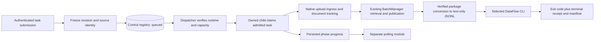

# Batch control: full business-chain integration

This phase connects the [isolated runtime](BatchRuntimeIsolation.md) to native document ingestion, evidence retrieval, query-data, center selection and the existing DataFlow conversion/CLI completion contract. It adds headless APIs and a separate polling contract. Existing default-workspace routes and running services remain independent.

## Deployment and configuration

The integration is opt-in. Copy and configure [`config/batch_control.example.yaml`](../../config/batch_control.example.yaml). Start a separate control-plane manager with the module entry point below. It constructs no default-workspace RAG and does not open the existing service's workspace. The example is not enabled automatically. No service has been restarted for this implementation.

After replacing the example's paths/model/environment values, run from `LightRAG/` with a chosen available port and an explicit API key:

```bash
LIGHTRAG_API_KEY="$RAG_KEY" .venv/bin/python -m lightrag.batch_control \
  --deployment /absolute/path/to/batch_control.yaml \
  --host 127.0.0.1 --port "$BATCH_MANAGER_PORT"
```

If an existing manager deployment intentionally uses the regular LightRAG server, `LIGHTRAG_BATCH_CONTROL_CONFIG` optionally mounts the same API and dispatcher there. Do not start a second regular LightRAG server against the live default file-backed workspace merely to obtain the control API; the standalone entry point avoids that extra writer.

The deployment owns configuration/runtime roots, RAG project/interpreter, storage credentials/endpoints, workflow environment references, input locations, model profiles and authorization grants. Relative paths in this file are resolved against its parent directory. The recipe's resource paths are resolved against the recipe's own parent. Interpreter symlinks are retained so virtual environments remain effective.

- `recipe_file` selects the initial current `difficulty_routed_qa` recipe. Published batches own independent immutable revisions thereafter.
- `inputs.<reference>` selects administrator-approved source directories/files. A request supplies reference IDs, never arbitrary filesystem paths.
- `profiles` selects RAG roles and embeddings. `credentials` maps references to private dotenv files; profiles name the exact key variable to read. Workflow model/key placeholders continue to come from the pinned recipe and its explicit workflow credential reference.
- `runtime.storage_credentials_file` contains explicit `NEO4J_URI`, `NEO4J_USERNAME`, `NEO4J_PASSWORD`, `MILVUS_URI`, etc. Do not include `NEO4J_WORKSPACE` or `MILVUS_WORKSPACE`; the batch owns those identities.
- `runtime.max_processes` limits RAG children in the shared registry. Each batch runs one business task at a time. This does not implement provider-wide model/token quotas.
- `retrieval.batch` accepts `graph_depth`, `rag_top_k`, `near_dedup` and `near_threshold`. A legacy `chunk_top_k` is not the evidence adapter's candidate setting and is rejected here; use `rag_top_k`. `retrieval.ordinary` accepts the query fields below. Per-task explicitly supplied fields override these defaults; unspecified fields retain batch defaults.

The adapter currently supports native parsing, fixed-token chunking and OpenAI-compatible model/embedding profiles, as in phase 2. Other runtime choices are rejected. The parser routing rule is compiled explicitly as `*:native`. Reranking and the enterprise overlay remain disabled for this managed adapter.

The manager's existing authentication runs with whitelist bypass disabled for all new endpoints. Anonymous/open-mode/guest access is refused even if old routes permit it. A validated shared API key maps to the server-owned principal `api-key`; a validated non-guest username maps to `user-` followed by the first 32 hex characters of its SHA-256. Requests cannot submit their own principal. Administrator `grants` must explicitly authorize each action and resource; no grant means denial. The standalone app requires an API key or configured accounts; it does not mount a login page. Non-guest JWT callers must use a token from the compatible existing authentication issuer.

Actions include `create`, `read`, `edit`, `submit`, `run_runtime`, `stop_runtime`, `cancel_task`, `audit` and existing reference-use permissions. The example explicitly grants administrative access to the shared API key. Production deployments should supply their intended grants.

## Task flow and durability



Task kinds are:

| Kind | Source | Behavior |
| --- | --- | --- |
| `ingest` | `directory` | Freeze supported native source files, import through existing upload ingress, wait for tracked documents and pipeline quiescence |
| `centers` | `index` | Reuse center recommendation on this batch's initialized RAG; no model call is introduced |
| `retrieval` | `index` | Retrieve explicitly selected centers through this batch's existing `BatchManager` |
| `distillation` | `retrieval` or `directory` | Read a verified publication, or parse approved JSON/JSONL query-data files; convert and execute the pinned workflow |
| `chain` | `directory` | Ingest, retrieve explicitly selected centers, convert and distill in that order |
| `query` | `index` | Call this batch's `aquery_data`; this task does not generate a final natural-language answer |

There is no center-count truncation. Centers are nonblank, at most 512 characters each, and duplicates retain first occurrence. Chain/retrieval requests require explicit centers. For interactive selection, run ingestion, then `centers`, then retrieval and distillation as separate tasks.

Submission atomically records the exact revision, manifest/components, Prompt digests, authorized principal, command and source snapshot. Retries with the same principal/request ID and identical command return the original task, including after inputs/configuration change. Reusing the key with a different command conflicts. Source enumeration outside the transaction never changes an already committed task's identity.

Directory snapshots retain file versions, content hashes, selected roots and exclusions. Descriptor-safe reads reject changed files and symlink redirection. Record/byte limits fail submission rather than silently submitting a subset. Hidden/archive/unsupported files are excluded and reported; no original file is modified. Ingestion may already have accepted earlier files when a later file changes or is rejected; those documents remain in the batch and the task fails after draining accepted background work. Inspect retained track IDs before an explicit new submission; no rollback deletes successful documents.

Published retrieval sources are resolved only inside the target batch's workspace ledger. Manifest identity, publication state, checksums and row counts are checked before submission and again before conversion. A source job ID from another batch is refused. Original shared-evidence references are not expanded into repeated text.

The worker verifies revision artifact hashes and RAG component identity before work. Recipe-only changes after submission do not switch queued work to new prompts/models/settings. Explicit topic catalogs are now captured with their content hashes in revision resources. Workflow commit/source, lock, interpreter and installed-distribution fingerprints are captured before submission and checked again before CLI execution. This establishes agreement with the captured environment; it is not a lockfile conformance audit. Secrets remain in explicit credential files or child environment, never task payloads.

## Execution and cancellation

The same `control.sqlite3` holds tasks, runtime capacity and append-only task events. States are `queued → admitted → running → terminal`; terminal states are `completed`, `completed_with_errors`, `failed`, `cancelled`, and `interrupted`. Admission transactionally matches runtime generation/lease and permits only one admitted/running task per batch. The child checks its actual PID/birth/startup identity before claiming.

The private file heartbeat remains the readiness protocol. Task commands travel through the private registry; no worker HTTP/Unix port is exposed. Native upload endpoints are called in-process through ASGI, preserving existing enqueue admission, parsing, processing and document tracking. Ingestion failure stops a chain before retrieval. Partial retrieval can hand off its valid published packages and remains an explicit partial task. Workflow rejections also produce partial task status.

The workflow adapter reuses `prepare`, `convert_result`, `write_job_config` and `execute`; it does not read legacy workspace overrides or call `RecipeSettingsStore` as a second authority. Job-local recipe and Prompt/catalog snapshots use the explicit control configuration root. A private source copy protects directory distillation from later file changes. The CLI receives an environment allowlist plus its explicit credential file, never inherited RAG model secrets.

One workflow input line remains exactly:

```json
{"text":"{\"entities\":[...],\"relationships\":[...],\"text_chunks\":[...]}"}
```

No final-answer Prompt or extra `meta` field is added. Completion requires the CLI exit code, terminal receipt and `run.json` identity/status to agree. Starting a process or writing stdout alone never marks success.

Cancelling queued/admitted work is immediate. Running ingestion requests the existing pipeline cancellation and waits for accepted work to stop; running retrieval finishes its current in-flight center before exiting; running distillation terminates its own CLI through the existing execution cleanup path. Retained data/artifacts are not deleted. A runtime stop closes new claims and waits for the active task before storage finalization; an unconfirmed exit retains the process reservation.

Manager shutdown stops its dispatcher and leaves owned children intact. A new manager recognizes current leases and task state. A confirmed lost runtime marks admitted/running tasks `interrupted`; it does not replay paid work. Unknown/foreign process ownership is retained for inspection. A runtime may retain its slot after becoming idle; explicitly stop it to free process capacity. Queued tasks report `waiting_reason` while capacity or a pending configuration application blocks them. The phase-4 [configuration application service](BatchConfigurationUI.md) handles pending RAG startup changes separately from task dispatch; index rebuilds remain outside this implementation.

## API contract

All paths below are under `/data-batches`. Normal API-prefix/root-path handling still applies.

| Method/path | Purpose |
| --- | --- |
| `POST /` | Create batch from deployment defaults (`name`, `request_id`) |
| `GET /` | List batches the authenticated principal can read |
| `GET /status` | Dispatcher availability, last successful tick and bounded error classification |
| `GET /{batch}` | Batch identity, active configuration and manifest digest |
| `PUT /{batch}/configuration` | Save with `expected_revision`, `request_id`, `configuration`; startup changes may remain pending |
| `GET /{batch}/runtime` | Runtime state and verified ready lease, or null lease |
| `POST /{batch}/runtime/start` | Explicitly start/reuse and wait for verified readiness |
| `POST /{batch}/runtime/stop` | Stop only the owned process and confirm exit |
| `POST /{batch}/tasks` | Durable submission; returns HTTP 202 without waiting for ingestion/model work |
| `GET /{batch}/tasks` | Task history for this batch |
| `GET /{batch}/tasks/{task}` | Independent progress poll |
| `POST /{batch}/tasks/{task}/cancel` | Request cooperative cancellation |
| `GET /{batch}/tasks/{task}/result` | Final task JSON after terminal state |
| `GET /{batch}/tasks/{task}/events` | Authorized task execution events |
| `GET /{batch}/tasks/{task}/logs` | Bounded stdout/stderr or audited task-generation worker log, read by byte offset |
| `GET /{batch}/tasks/{task}/artifacts` | List available fixed artifacts with filenames and byte counts |
| `GET /{batch}/tasks/{task}/artifacts/{artifact}` | Download a fixed named artifact; arbitrary paths are not accepted |

Artifact names are `retrieval-packages`, `retrieval-sources`, `retrieval-manifest`, `workflow-input`, `workflow-review` and `workflow-run`. Workflow review output is the raw workflow result; no training-format conversion is introduced. Availability depends on the task stages and confirmed publication/receipt.

The progress module now inspects final task JSON, paginates workflow/worker logs,
lists available files and downloads them through the authenticated batch client.
It does not place authentication secrets in download URLs. Worker logs use the
task's recorded generation, including after a later generation has started;
they require the batch `audit` permission. Results and files reject a foreign
batch/task association. Late reads/cancellation continuations cannot update the
next selected batch. Request scope cleanup also supports StrictMode effect
replay instead of permanently aborting a reused controller.

The query page first loads the batch's active ordinary-retrieval defaults.
Browser overrides and prompt histories are keyed by signed-in identity, batch
and defaults profile. Returning from settings refreshes active defaults; an
earlier profile's overrides are not applied to a changed profile. A pending
desired configuration does not supply active defaults. Invalid known query
parameters fail before the query form appears, with an explicit reload action.

Example complete-chain request:

```json
{
  "expected_revision": "rev-REPLACE",
  "request_id": "chain-click-001",
  "kind": "chain",
  "source": {"type": "directory", "data_batch_id": "batch-REPLACE", "input_ids": ["documents"]},
  "centers": ["实体A", "实体B"],
  "retrieval": {"graph_depth": 1, "rag_top_k": 10}
}
```

For retrieval use `kind: "retrieval"` and `source: {"type":"index","data_batch_id":"batch-REPLACE"}`. For distillation from that result use `kind: "distillation"` and `source: {"type":"retrieval","data_batch_id":"batch-REPLACE","retrieval_job_id":"<result.retrieval.job_id>"}`. An `ingest` request uses directory source with no centers. A `query` request uses index source and `query: {"query":"问题", "mode":"mix"}`. A `centers` request uses index source and optional `selection: {"min_neighbors":3,"min_documents":2}`.

Task responses carry `task_id`, `data_batch_id`, `config_revision_id`, `state`, `phase`, generation, actual progress, result/error, timestamps, `terminal`, `poll_after_ms` and root-path-aware links. Progress units are documents during ingestion, centers during retrieval, queries during query-data, and sources during distillation. Workflow source percent remains null until observed committed counts exist. No invented overall percentage combines unlike units. The start button submits once; a separate display polls `links.status` at `poll_after_ms` until terminal.

## Artifacts and acceptance

Task artifacts live under `runtime_root/tasks/<batch-namespace>/<task-id>/`, retrieval exports under `runtime_root/retrieval/<workspace>/<retrieval-job>/`, workflow receipts/logs under the task's `workflow/`, and immutable job configuration under `config_root/jobs/`. The control registry is the configuration/task authority; existing workspace services are not switched to it automatically.

The [execution record](BatchControlExecution.md) distinguishes real local RAG/ingress/retrieval/conversion checks, real subprocess/CLI-protocol checks and deterministic model fixtures. Live Neo4j/Milvus, real external model inference and production activation have not been accepted in this environment. The phase-4 [settings UI](BatchConfigurationUI.md) adds configuration editing and a separate application-progress module using the same batch authority. Business-task page placement, rebuilds, live adoption, global model quotas and training-format export remain separate work.
